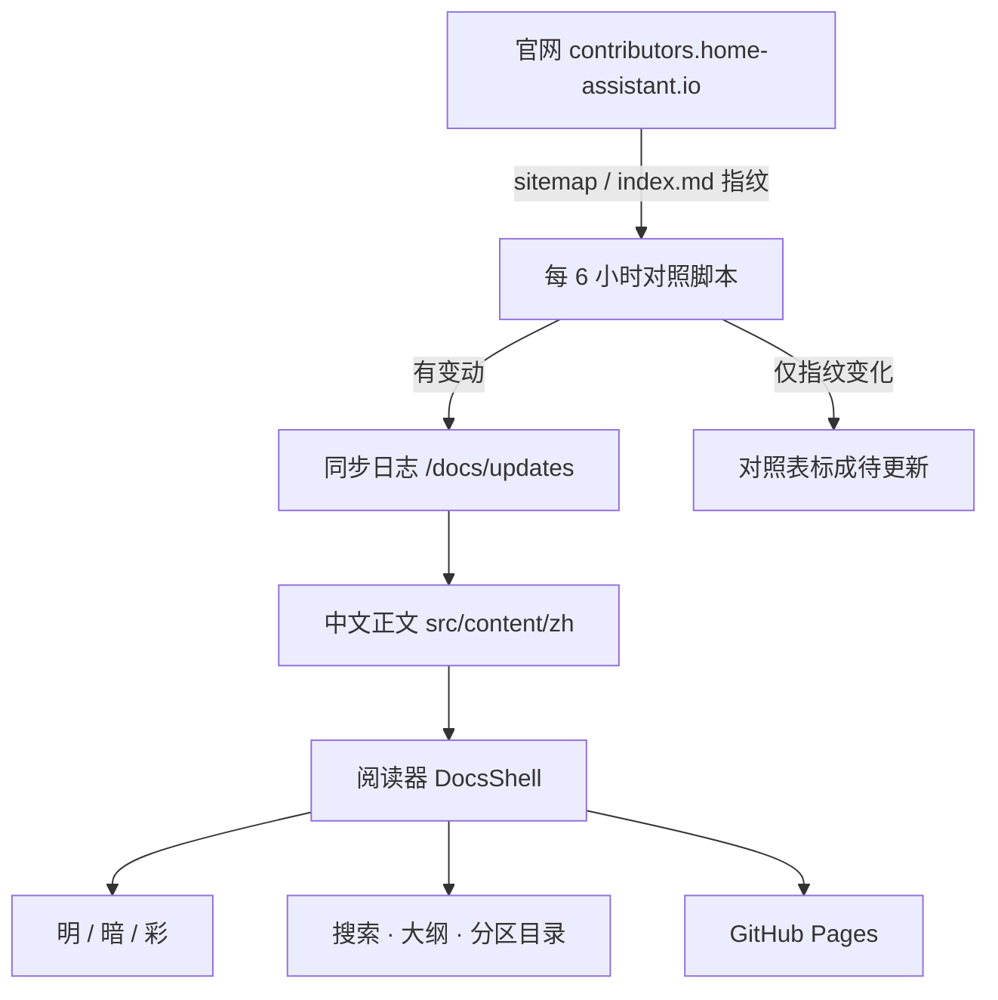

# 本站架构 {#architecture-site}

本站是 Home Assistant 贡献者官方文档的中文阅读器，不是 Home Assistant 产品本身，也不替代 [contributors.home-assistant.io](https://contributors.home-assistant.io/)。产品与项目架构见 [架构](/architecture)。

## 阅读器 {#reader}

- 正文在 `src/content/zh/**/*.md`，标题带 `{#english-id}` 以对齐官网锚点。
- 侧栏目录按官网分区与文件夹结构生成，路径与官网一致（本站部署在 `/ha-contributors-handbook/` 之下）。
- 渲染器支持标题、列表、表格、代码、引用、GitHub 风格提示块，以及 Mermaid。
- 官方页面里的交互式演示（如设计组件的实时控件）无法在静态阅读器中完整复现：译文保留示例标记，并链到官网原文。

## 同步 {#sync}

- `npm run sync:docs` 拉取 sitemap 与各页 `index.md`，计算指纹，写入 `official-map.json` 与同步日志。
- GitHub Actions 在推送到 `main` 时构建并部署；同时每 6 小时跑一次对照。
- 对照脚本**不会自动重写译文**。哈希变化只会在对照表里标成待更新，并在同步日志里写明中文站路径。

## 许可 {#license}

译文按 [CC BY-NC-SA 4.0](https://creativecommons.org/licenses/by-nc-sa/4.0/) 共享。官方文档站点本身没有在源仓库根目录放 LICENSE；home-assistant.io 的文档许可是 CC BY-NC-SA 4.0，代码是 Apache 2.0。详见官网 [许可与 CLA](https://contributors.home-assistant.io/start/licensing/)。
