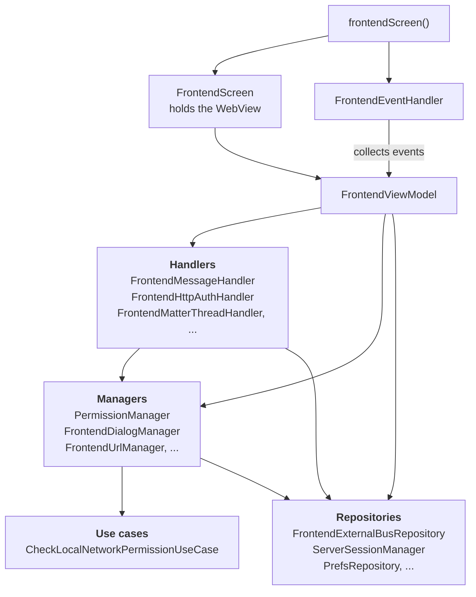
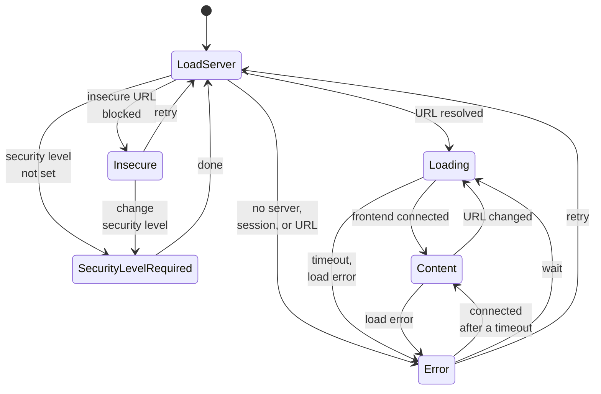
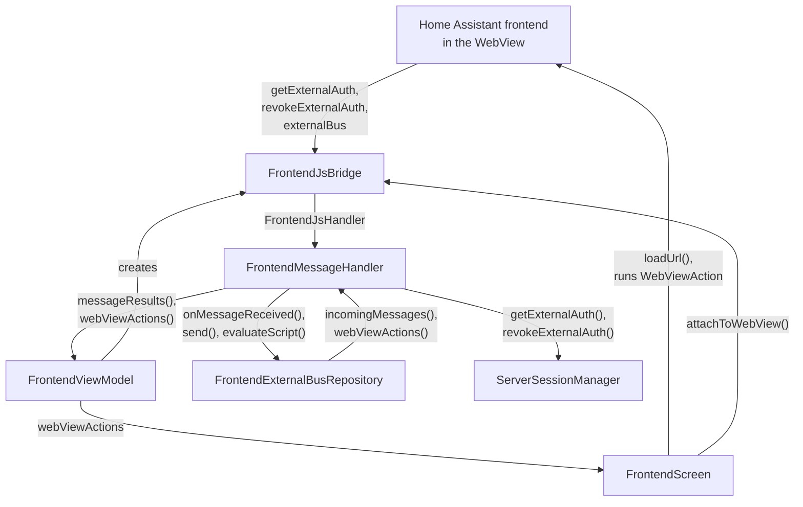

# 前端屏幕 {#the-frontend-screen}

前端屏幕显示 Home Assistant 前端在一个 [WebView](https://developer.android.com/reference/android/webkit/WebView) 中，并结合了本地功能：身份验证、手势、下载、NFC、Matter 和 Thread，以及媒体播放。它是应用中最复杂的屏幕，也是 [UI 架构](/companion/android/ui-architecture) 的参考实现。它的输入来源广泛：用户、Web 视图、外部总线、系统回调以及超时。这正是该模式设计的目标场景。代码位于 [`frontend/`](https://github.com/home-assistant/android/tree/main/app/src/main/kotlin/io/homeassistant/companion/android/frontend) 包中。旧的 `webview/` 包是正在被移除的遗留实现。

## 组件 {#the-pieces}

| 模式中的角色 | 前端实现 |
| --- | --- |
| 导航和事件 | `frontendScreen()`, `FrontendEventHandler` |
| 视图 | `FrontendScreen`, `FrontendScreenContent` |
| 视图模型 | `FrontendViewModel` |
| 状态 | `FrontendViewState` |
| 事件 | `FrontendEvent` |
| 操作 | `WebViewAction` |
| 提示 | `SingleSlotQueue` 与 `FrontendDialog`, `PermissionRequest`, `FileChooserRequest` |
| 处理器 | `FrontendMessageHandler`, `FrontendMatterThreadHandler`, `FrontendHttpAuthHandler`, `FrontendFileChooserHandler`，等等 |
| 管理器 | `PermissionManager`, `FrontendDialogManager`, `FrontendUrlManager`, `FrontendDownloadManager`, `FrontendGestureManager`, `FrontendExoPlayerManager`，等等 |
| 仓库 | `FrontendExternalBusRepository`, `ServerSessionManager` |

它们的依赖关系遵循模式的层次，只指向下一层：



在运行时，结果会通过每层暴露的流程向上流动。管理器推送屏幕渲染的待处理状态，处理器推送视图模型进行归约的结果，仓库发送类型化消息供处理器使用。

## 状态和覆盖层 {#states-and-overlays}

`FrontendScreen` 总是在底部渲染 web 视图，并根据状态在上方绘制一个覆盖层。web 视图保持挂载在下方，因此覆盖层变化时页面保持不变。

| 状态 | 覆盖层 |
| --- | --- |
| `LoadServer`, `Loading` | 加载指示器 |
| `Content` | 无，前端内容显示在下方 |
| `SecurityLevelRequired` | 连接安全级别设置 |
| `Insecure` | 不安全连接屏幕 |
| `Error` | 连接错误屏幕 |`LoadServer` 是入口点。它还会通过加载 `about:blank` 清空网页视图，同时 ViewModel 解析要加载的 URL。从那里，它会移动到 `Loading`、`Insecure`、`SecurityLevelRequired` 或 `Error`。`Loading` 一旦前端通过外部总线连接，就会移动到 `Content`。2026.8 以后的服务器还会报告前端已完成渲染，并且加载指示器会一直显示到那时。超时或加载错误会移动到 `Error`，重试则返回 `LoadServer`。切换服务器也会重新进入 `LoadServer`。有一种错误无法重试：`FrontendConnectionError.Unrecoverable`，例如系统 WebView 启动失败。ViewModel 会忽略从该 `Error` 状态的任何转变。

各状态之间的主要转换：



### 重用错误屏幕 {#reusing-the-error-screen}

连接错误屏幕与引导界面共享，因此它不能依赖`FrontendViewModel`。它依赖一个只包含所需内容的小型接口，`FrontendConnectionErrorStateProvider`：

```kotlin
interface FrontendConnectionErrorStateProvider {
    val urlFlow: StateFlow<String?>
    val errorFlow: StateFlow<FrontendConnectionError?>
    val connectivityCheckState: StateFlow<ConnectivityCheckState>
    fun runConnectivityChecks()
}
```

`FrontendConnectionErrorScreen` 是针对这个接口编写的。`FrontendViewModel` 实现了它，因此错误覆盖层将 ViewModel 本身作为其提供者。预览和测试使用 `FrontendConnectionErrorStateProvider.noOp`。

这是在不同屏幕之间重用 UI 或逻辑的一般技巧：为可重用部分正好所需的内容定义一个接口，并让每个 ViewModel 去实现它。然后依赖项指向该接口，而不是指向某个特定的 ViewModel。

## 网页视图 {#the-web-view}

`FrontendScreen` 通过 `HAWebView` 创建网页视图，这是一个可重用的可组合组件。它在 `AndroidView` 内创建平台 `WebView`，应用基本设置，在导航主机之前将返回按钮发送到网页视图历史记录，并在预览和截图测试中显示占位符。当创建网页视图失败时，它会报告此情况，ViewModel 将其转化为不可恢复的 `Error` 状态。

在此基础上，`FrontendScreen` 添加了仅前端需要的功能：它附加了以下两个客户端，启用 cookies（包括某些集成依赖的第三方 cookies），并连接下载和手势监听器。

ViewModel 创建网页视图的两个客户端：- `HAWebViewClient` 来自 `HAWebViewClientFactory`。它处理 TLS 客户端证书，映射加载和 TLS 错误，报告已完成的页面加载，显示 HTTP 基本身份验证挑战，并在渲染器崩溃时恢复。
- `HAWebChromeClient` 来自 `viewModel.createWebChromeClient()`。它处理摄像头和麦克风权限请求，JavaScript `confirm()` 对话框，文件选择器，以及全屏视频。

> [!注意]
> ViewModel 通常不持有任何平台 UI 类型。这些客户端是唯一被接受的例外，因为它们与 ViewModel 逻辑相关联：错误映射、页面加载回调、HTTP 认证和权限。它不会影响可测试性：Web 视图客户端来自测试可以伪造的工厂，Chrome 客户端只有在屏幕请求时才会构建。ViewModel 的精简逻辑仍然作为普通的 JVM 单元测试运行。

## 与前端通信 {#talking-to-the-frontend}

前端和应用通过 JavaScript 桥进行通信。它承担两项功能：

- **外部认证**：前端向应用请求访问令牌，而不是显示登录页面。
- **外部总线**：双向消息传递，例如打开原生设置、扫描二维码或启动 Assist。

前端部分在 [外部认证](/frontend/reference/external-auth) 和 [外部总线](/frontend/reference/external-bus) 中有文档说明。

`FrontendJsBridge` 是在 Web 视图中注册的 JavaScript 接口。它将来自前端的调用解析为类型化消息，并交给 `FrontendMessageHandler`。`FrontendExternalBusRepository` 拥有总线本身：它反序列化传入的 JSON，容忍未知消息类型，并将传出的消息转换为脚本。

`FrontendScreen` 以下的内容不涉及 Web 视图。其他所有内容都通过流程进行通信：



用文字来说：- **前端到应用**：前端调用桥接，处理器将消息传给仓库，结果作为类型化事件返回到 ViewModel。 
- **应用到前端**：组件发送类型化消息到仓库，仓库将其封装在 `WebViewAction.EvaluateScript` 中。`FrontendScreen` 在 Web 视图中运行它。 
- **身份验证**：前端调用 `getExternalAuth` 或 `revokeExternalAuth`，处理器询问 `ServerSessionManager`，回调脚本在 Web 视图中运行。桥接在传递调用之前会检查回调名称。

操作和事件流是带有小额外缓冲的 `SharedFlow`，所以发送者在 Web 视图仍在处理早期命令时无需等待。然而，它们不会重放：在没有任何接收端收集流程时发送的命令会被丢弃。

### 两个桥接版本 {#two-bridge-versions}

桥接存在两个版本：

- **V1** (`window.externalApp`) 使用 `addJavascriptInterface`。前端直接调用命名方法。
- **V2** (`window.externalAppV2`) 使用 `WebViewCompat.addWebMessageListener`，适用于 Home Assistant 2026.4.2 及更高版本。所有消息通过 `postMessage` 以 JSON 格式发送，并带有 `type`，通过源和框架进行安全过滤。

当服务器版本足够新且设备的 WebView 支持 `WEB_MESSAGE_LISTENER` 功能时，应用使用 V2。否则，会回退到 V1。

## 范围 {#scoping}

一个屏幕会话的块是 `@ViewModelScoped`。这包括 `FrontendExternalBusRepository`：总线仅存在于一个 WebView 中，因此来自一次访问的缓冲消息不会泄漏到下一次访问。`FrontendHandlerModule` 将 `FrontendMessageHandler` 绑定为 `FrontendJsHandler` 和 `FrontendBusObserver` 在 `ViewModelComponent` 中，因此两个角色共享一个实例。

## 测试 {#testing}

| 什么 | 测试类型 |
| --- | --- |
| `FrontendViewModel` | 使用 JUnit 和 Turbine 的单元测试 |
| 管理器和处理器 | 单元测试，每次一个关注点 |
| `FrontendScreenContent` | Compose UI 测试，每个状态 |
| `FrontendEventHandler` | Compose UI 测试，每个事件一个 |
| `FrontendScreen` | 截图测试，只看外观，不测试逻辑 |
