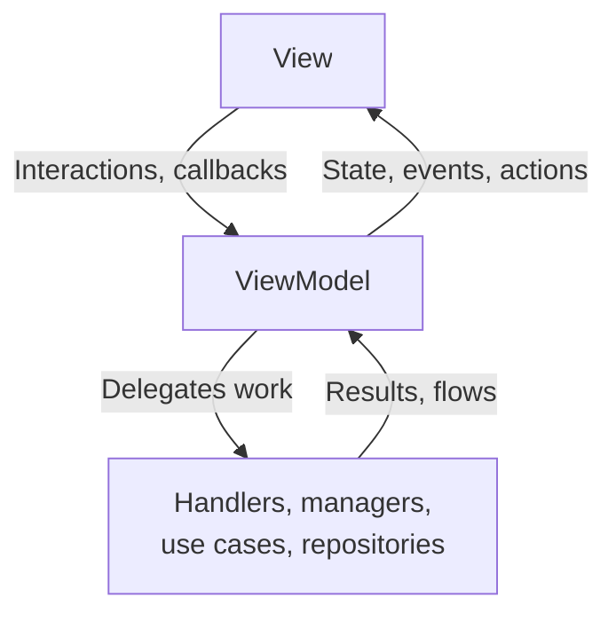
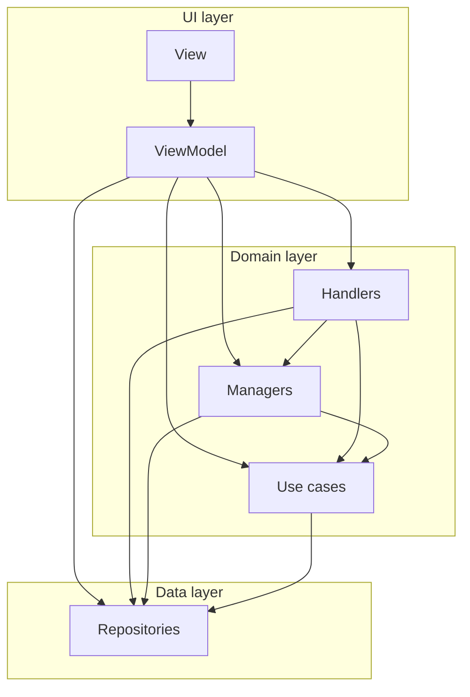

# Android UI 架构 {#android-ui-architecture}
每个新屏幕都hyed这个模式。 这是类似MVI的Google的[建议应用架构](https://developer.android.com/topic/architecture):相同的UI,域,和数据层,对输入和输出流有严格的合同. 现有的屏幕随时间推移而迁移。 [前端屏幕](/companion/android/frontend-screen)是参考执行。

## 为什么这个模式 {#why-this-pattern}

屏幕同时有许多输入:用户,系统回调如权限结果,定时器,以及外部消息. 模式将其全部缩减为少数定义明确的输出,因此屏幕保持可预见和可测试性.

也保持屏幕小。 没有结构,屏幕就会成长成一个了解一切的VideoModel,无法安全测试或更改. 在这里,每一个问题都生活在自己的小街区里,只有一份工作。

## 流动 {#the-flow}

输入到视图模型中。 ViewModel代表工作到它下面的块块,并将结果减少到最多3个产出,这些产出可追溯到视图。 数据只朝一个方向走:



三项产出:

| 产出 | 这是什么 | 示例 |
| --- | --- | --- |
| 状态 | 做点什么? 一个值,总是当前 | 服务器列表, 装入旗 |
| 傀儡 | 一弹一弹的效果必须发生一次 | 导航回来, 显示小吃栏 |
| 动作 | 只有视图所持对象的命令 | 方面也重新装入网页视图, 滚动到顶端 |

大多数投入只是产生了一个新的状态。 大部分屏幕从不需要动作.

## 作出有效决定 {#the-view}

视图为"编曲屏". 它使状态,通过调用来报告交互,并拥有任何UI处理下层不得触碰,如`WebView`或`LazyListState`.

将每个屏幕分割成一个状态的切入点和一个无国籍内容可混杂. 预览、截图测试和编译测试然后直接驱动内容:

```kotlin
@Composable
internal fun SettingsScreen(viewModel: SettingsViewModel) {
    val viewState by viewModel.viewState.collectAsStateWithLifecycle()

    SettingsScreenContent(
        viewState = viewState,
        onNameChange = viewModel::onNameChange,
    )
}

@Composable
internal fun SettingsScreenContent(
    viewState: SettingsViewState,
    onNameChange: (String) -> Unit,
) {
    // Renders viewState, reports interactions through the callbacks
}
```

## 视图模式 {#the-viewmodel}

ViewModel 拥有输出并将块连接在一起:

```kotlin
val viewState: StateFlow<UiState> // what to render
val events: Flow<UiEvent>         // one-shot effects, from a Channel
val actions: Flow<UiAction>       // only if the view owns a handle
```

规则 Judaism.

- 它从不引用Compose或平台UI类型,因此其逻辑运行为普通JVM单元测试.
- 它的寿命超过配置变化. `viewModelScope` 只有在屏幕消失后才会取消, 所以旋转不会重新开始装入或流集 。
- 令其细细. 一个小屏幕可以在 ViewModel 中保留其逻辑. 当它生长时, 移动到下面的 [块](/companion/android/ui-architecture#the-blocks) 中 。

### 状态 {#state}

状态是屏幕上真相的唯一来源。

- ** 无法改变。 ** 使用 `val` 和不可改变的收藏, 用 `copy()` 来修改 。 在Compose中就地突变断裂变检测.
- ** 结构性平等。 ** 使用数据类. `StateFlow` 跳过与当前值相等的值, 因此, 释放相同的状态再次花费什么 。
- ** 选读。 ** 编曲在主线上读取状态,每次重构时都读取状态. 永远不要在计算器。 使用背景调度器计算状态:

```kotlin
// Bad: maps the list on every recomposition, on the main thread
data class UiState(val servers: List<Server>) {
    val serverItems: List<HADropdownItem<Int>>
        get() = servers.map { HADropdownItem(it.id, it.friendlyName) }
}

// Good: mapped once, when the state is created
data class UiState(val serverItems: List<HADropdownItem<Int>>)
```

将状态塑造到屏幕上。 当屏幕看起来总是一样时,一个数据类就起作用了. 当屏幕有不同的模式时,使用一个密封的层次,因此编译器强迫您处理一个模式的每个模式和字段,不能泄露到另一个模式:

```kotlin
sealed interface UiState {
    data object Loading : UiState
    data class Content(val items: List<Item>) : UiState
    data class Error(val error: ErrorReason) : UiState
}
```

### 傀儡 {#events}

事件是火灾和遗忘:导航,显示小吃栏,打开链接. 把它们模拟为一个密封的接口,恺号的`when`是详尽的:

```kotlin
sealed interface UiEvent {
    data object NavigateBack : UiEvent
    data class ShowSnackbar(@StringRes val messageResId: Int) : UiEvent
}
```

通过 `Channel` 发送它们, 以 `receiveAsFlow()` 的 `Flow` 暴露为 `Flow` , 每一次消费一次, 通常在导航层 。 缓冲的`Channel`为它的单一消费者举办活动,所以在收藏家开始前发送的事件仍然到来,在那里一个`SharedFlow`没有重放它. 见[选择流程类型](/companion/android/architecture#picking-a-flow-type). 永远不要重放一个事件:在重新组合两次后重放"navigate back". 如果UI在旋转后必须再次显示一些东西,那就是状态,而不是事件.

### 动作 {#actions}

一些对象必须生活在视图中,因为编曲创建了它们:一个`WebView`,一个`LazyListState`,一个焦点请求器. 景模无法控制它们. 然而,有些行动是必须的,例如“现在重装”。

对于这些,VideoModel会发出一个按键的动作,视图会将其运行在它拥有的对象上. 每个动作都带有自己的`run` :

```kotlin
sealed interface WebViewAction {
    fun run(webView: WebView)

    data object Reload : WebViewAction {
        override fun run(webView: WebView) = webView.reload()
    }
}

// In the view, the only place that holds the WebView
LaunchedEffect(webView) {
    webViewActions.collect { action -> action.run(webView) }
}
```

流量为`SharedFlow`,带有一个小的额外缓冲,消耗一次. 它不重播:一个在视图消失时发送的动作被丢弃,这个命令只代表该视图现在持有的对象的某物. 当一个动作不能被放弃时, 请先等待一个收藏家, 如 `FrontendViewModel` 与 `subscriptionCount` 一样, 在它释放前 。 需要结果的动作可以携带 `CompletableDeferred` 。

动作不是状态:每次重组时,状态会再次运行的命令。 它也不是一个事件:一个事件是主机的反应信号,就像导航一样,而一个动作驱动这个屏幕拥有的一个对象.

只为必须存在于视图中的对象使用动作 。 例如,媒体播放器可以生活在管理器中,并作为状态被曝光. 实际上,屏幕最多有一个这样的物体,通常没有。

### 选择一个输出 {#choosing-an-output}

问其产出是何物,而非从何而来:

| 如果输出 | 使用 | 为什么 |
| --- | --- | --- |
| 决定产生什么,必须在重新组合和轮换后生存 | 状态 | 重现相同的值是不可更改的 |
| 是副作用 必须发生一次 | 积极地濑子事件 | 重放会导航或显示小吃栏两次 |
| 是一个对视图中对象的命令 | 行动 | 视图模式没有UI类型 |
| 问用户什么,等待答案 | 启动管理器 | 每次一个提示,呼叫者暂停,直到用户回答 |

## 块 {#the-blocks}

ViewModel代表的逻辑特征为四种区块. 每类以同类命名:`*Repository`,`*UseCase`,`*Manager`,`*Handler`.

| 诘问 | 这是什么 | 可能取决于 |
| --- | --- | --- |
| 仓库 | 一个数据源或信道的单一真理源:存储,网络,一个室DAO,一个外部总线 | 只提供数据源, 永远不要另设寄存器 |
| 使用大小写 | 一个无国籍,可重复操作, 暴露为 `operator fun invoke()` | 仓库 |
| 经理 | 一个特征的逻辑和内在状态 | 仓库,其目的在于使用案例,平台API. 永远不要其目的在于管理者 |
| 处理器 | 协调一个或多个管理者的 过去逻辑 | 管理者,使用案件,寄存器。 再也不会有人管了 |

管理者与管理者之间的区别是一个问题:它取决于管理者吗? 如果是,它是一个处理者。 无论它持有状态,还是翻译一个输入相对于驱动一个多步流,都无关紧要:处理器可以是其中任何一个. 这条规则使得管理人员对管理人员的依赖性从定义上讲是不可能的.

处理器将它的工作作为密封结果,或作为结果流返回到 ViewModel 中. 它可能为自己的特性保留状态,即VideoModel地图进入屏幕状态. 屏幕状态总是属于 ViewModel.

管理者通过三种方式对屏幕说话: 它以 `StateFlow` 显示待决状态 视图生成,它返回一个 `suspend` 函数的封存结果,或者它暴露一个 `Flow` 的结果。

管理员也是提示的活点:一个对话框,一个权限请求,或者一个等待用户答案的文件拾取器. 使用 `SingleSlotQueue` 用于这些 。 它魄一次显示一个提示,将当前请求暴露为状态,让呼叫者`awaitResult`直到用户回答. 一个提示不是第四个输出:它正在等待显示视图,答案作为正常输入回来。

当一个以上调用者需要逻辑时, 或会 bloat a ViewModel 或 管理器, 但是没有自己的状态时, 联系到一个使用大小写 。 例子有`CheckLocalNetworkPermissionUseCase`和`ServerChooserItemsUseCase`。

数据库访问也通过一个寄存器:Room DAO是数据源,寄存器是其他应用程序所看到的. 合并几个数据源是逻辑的,所以它属于一个使用大小写,管理器,或处理器,而不是寄存器.

### 选择块 {#choosing-a-block}

工作从头到尾。 第一行合拍胜负:

| 你有过 | 使用 |
| --- | --- |
| 访问数据源或通信通道 | 仓库 |
| 一个没有状态的可重复操作 | 使用大小写 |
| 的目的之一,就是关注国家 | 经理 |
| 协调管理者的逻辑 | 处理器 |
| 全屏幕状态和协调 | 查看模式 |

## 图层和 大家都有依附关系 {#layers-and-dependencies}

视图和视图模型是UI层. 处理器,管理器,和使用大小写是域层. 仓库是数据层. 依赖性仅指向下:

- ViewModel可以直接使用任意块.
- 交易员使用管理器,使用案件和寄存器。
- 管理人员使用案件和储存库。
- 使用数据库。
- 没有处理器使用另一个处理器. 维基百科中的坐标处理器.
- ViewModel只提取一个处理器, 一旦协调管理者 否则会膨胀它。

和图表一样,每个箭头都指向:



没有指点或侧面。 这使得图表没有周期,每个区块都可以自行测试.

## 范围界定 {#scoping}

其状态必须维持多久的范围:

- 属于一个屏幕的块是 `@ViewModelScoped` 。 屏幕会话中的所有内容都共享一个实例,当会话结束时会重排.
- 一个代表全应用关注的块通常是`@Singleton`.

共同案例很重要。 如果 ViewModel 和处理器都注入了状态管理器,它们必须获得相同的对象,否则它们对于状态的视角会漂移. 一个无范围绑定给每个消费者自己的副本. 这才是状态问题所在:一个有状态的街区需要一个与状态存在时间相匹配的范围。

通过希尔特提供一切。 永远不要用手创造这些块。

## 测试 {#testing}

拆分是使得屏幕可以测试的原因:

| 层 | 测试类型 | 检查什么 |
| --- | --- | --- |
| 查看模式 | 单位 | 哪些输入产生哪个一句话、事件或动作 |
| 处理者、管理人员、使用案件 | 单位 | 每一个关切本身 |
| 无国籍内容 | 编写用户界面 | 每个状态的渲染, 而交互调用正确的回调 |
| 事件处理 | 编写用户界面 | 每个事件触发正确的导航或效果 |
| 屏幕 | 截图 | 只看,没有逻辑 |

见[测试](/companion/android/testing)和[截图测试](/companion/android/screenshot-testing)。
