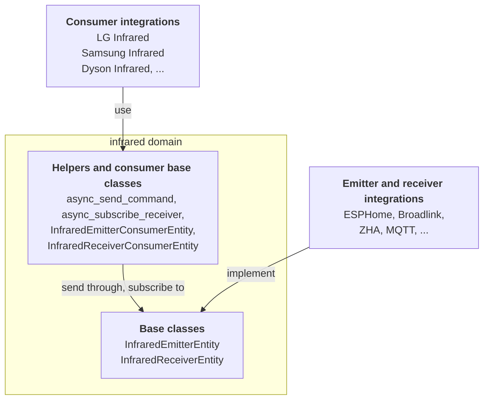

# 红外实体 {#infrared-entity}

红外线域将红外线控制一分为二. 一些集成拥有硬件: ESPHome 棋盘或 Broadlink 中枢,带有IR LED或IR接收器. 其他集成器则知道一个设备:哪个代码打开一个Dyson风扇,或者切换一个Edifier扬声器的输入. 随着红外域在两者之间,一个设备集成与任何IR硬件一起工作,一个硬件集成不需要知道单个设备.

有三个角色:

- ** Emitter集成** 自己的硬件,发送IR信号. 它们提供了一个基于`InfraredEmitterEntity`的实体。
- ** 接收器集成** 自己接收IR信号的硬件. 它们提供了一个基于`InfraredReceiverEntity`的实体。
- ** 消费者一体化** 了解一种装置及其编码。 它们不创建红外线实体。 它们创建普通实体,如[按钮](/core/entities/button),[风扇](/core/entities/fan)或[媒体播放器](/core/entities/media-player),并通过一个发送器或接收器发送或接收用户所选择的,通常在配置流中.

角色如何通过红外线域连接:



一切众生住`homeassistant.components.infrared`. 命令本身来自 [`infrared-protocols`](https://github.com/home-assistant-libs/infrared-protocols) 库 。 关于同样带有无线电信号的图案,请参见[无线电频率实体](/core/entities/radio-frequency).

## 的临时议程 {#properties}

采取协调一致的措施,确保所有实体都拥有自己的财产。采取协调一致的方法 。

基础课为您设置了一些东西:

| 名称 | 数值 | 说明 |
| --- | --- | --- |
| `device_class` | `InfraredDeviceClass.EMITTER` or `InfraredDeviceClass.RECEIVER` | 由基类设定. 无名称的实体以其设备类命名. |
| `should_poll` | `False` | 红外线实体从不投票 |
| `state` | 最终 | 最后一个命令发送或信号接收的时间 。 见[国家](/core/entities/infrared#states). |

两个基础类都扩展`RestoreEntity`,所以最后一个时间戳存活在重启中.

## 支持的特性 {#supported-features}

红外线实体没有辅助特征。 实体不是发射者就是接收者。 如果硬件两者兼而有之,则创建每个实体的一个实体.

## 发送器 {#emitter}

执行`async_send_command`。 它接收到`InfraredCommand` (`Command`的基级为`infrared-protocols`,由红外线域再导出),并在失败时必须发送,或提高`HomeAssistantError`. 你需要的一切都在命令上:`modulation`是Hz中的载体频率,`get_raw_timings()`以微秒返回时间(正值为脉冲,负值为空格).

```python
class MyInfraredEmitter(InfraredEmitterEntity):
    async def async_send_command(self, command: InfraredCommand) -> None:
        """Send an IR command."""
```

不要从其他代码调用这种方法 。 消费者通过`async_send_command`帮助者,验证实体,通过上下文,并在成功发送后更新状态.

## 接收者 {#receiver}

在接收器上没有执行方法。 当硬件接收到信号时,用 `_handle_received_signal` 把它交给基座类. 基础类更新状态并给每个订阅者打电话.

```python
class MyInfraredReceiver(InfraredReceiverEntity):
    @callback
    def _on_hardware_signal(self, timings: list[int]) -> None:
        """Pass a signal from the hardware on to subscribers."""
        self._handle_received_signal(InfraredReceivedSignal(timings=timings))
```

`InfraredReceivedSignal` 持有 `timings` (列表 `int`) 和可选 `modulation` 。 从事件循环调用 `_handle_received_signal` 。

## 消费者援助人员 {#consumer-helpers}

消费者从不提红外线实体。 他们与实体ID(或注册ID)和这些帮助者合作:

| 帮助者 | 说明 |
| --- | --- |
| `async_get_emitters(hass)` | 所有排放实体的实体身份谐音。 用它来提供您谐音流中的选择 。 |
| `async_get_receivers(hass)` | 所有接收实体的实体身份。 |
| `async_send_command(hass, entity_id_or_uuid, command, context=None)` | 通过发射器发送命令。 当红外线域未加载或发射器不存在时升起`HomeAssistantError`. |
| `async_subscribe_receiver(hass, entity_id_or_uuid, signal_callback)` | 呼叫 `signal_callback` 用 `InfraredReceivedSignal` 每个信号 。 返回召回到未订阅者 。 当红外域未加载或接收器不存在时,升起`HomeAssistantError`. |

大多数消费者并不直接需要帮助,因为有两个基础班为他们工作:

- `InfraredEmitterConsumerEntity`: 设置 `_infrared_emitter_entity_id`,然后呼叫 `await self._send_command(command)` 。 该实体只在发射人出现时才提供,行动的背景也相传.
- `InfraredReceiverConsumerEntity`: 设置 `_infrared_receiver_entity_id` 并执行 `_handle_signal(signal)` 回调 。 基础类在接收器可用时订阅,在离开或实体被移除时不订阅.

在您平台的实体类之前把它们混合, 如 `class MyButton(InfraredEmitterConsumerEntity, ButtonEntity)` 。 当您超过 `_async_infrared_availability_changed` 对可用性作出反应时, 请先拨打 `super()` 。

> [!NOTE]
> `InfraredEntity`和`InfraredEntityDescription`是发射班的变种,停止在Home Assistant2027.6. 使用`InfraredEmitterEntity`和`InfraredEmitterEntityDescription`。

## 方法 {#methods}

| 作用 | 就在那时 | 说明 |
| --- | --- | --- |
| 发送器 | `async_send_command(command)` | 要求。 将命令发送到硬件上. 没有同步变体。 |
| 接收者 | 无 | 当一个信号到达时呼叫`_handle_received_signal(signal)`. |
| 接收消费者 | `_handle_signal(signal)` | 要求。 一个处理接收信号的回调. |

## 状态 {#states}

发射器状态是最后一个命令发出的时间. 接收器状态是最后一次接收信号的时间. 两者都是带有毫秒的ISO 8601印记,如`2026-10-10T08:15:00.123+00:00`,或`unknown`在第一个印记之前. 州终:基班管理.

## 示例 {#example}

一个消费者按钮,通过用户在配置流中选择的发送器打开电视.

```python
from infrared_protocols.commands.nec import NECCommand

from homeassistant.components.button import ButtonEntity
from homeassistant.components.infrared import InfraredEmitterConsumerEntity

POWER_ON = NECCommand(address=0x04, command=0x08)

class MyTvPowerButton(InfraredEmitterConsumerEntity, ButtonEntity):
    """Turn on the TV over infrared."""

    _attr_has_entity_name = True
    _attr_translation_key = "power_on"

    def __init__(self, entry_id: str, emitter_entity_id: str) -> None:
        """Initialize the button."""
        self._attr_unique_id = f"{entry_id}_power_on"
        self._infrared_emitter_entity_id = emitter_entity_id

    async def async_press(self) -> None:
        """Send the power on code."""
        await self._send_command(POWER_ON)
```
