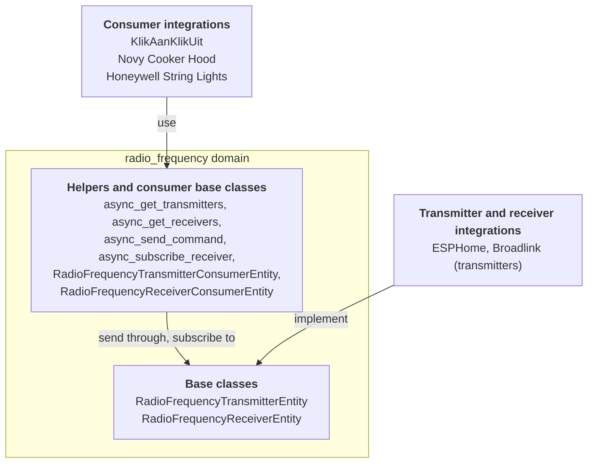

# 无线电频率实体 {#radio-frequency-entity}

射频域位于RF硬件和它控制的设备之间. 大量廉价设备在433 MHz或868 MHz上收听简单的无线电编码:车库门,无线插座,弦灯,炊具罩. 一个集成拥有收音机,如ESPHome板或Broadlink中枢. 另一个集成体知道一个设备及其代码. 无线电频率域让他们在互不知情的情况下一起工作.

有三个角色:

- ** 传输器集成** 本身发送RF信号的硬件。 它们提供了一个基于`RadioFrequencyTransmitterEntity`的实体。
- ** 接收器集成** 自己接收RF信号的硬件. 它们提供了一个基于`RadioFrequencyReceiverEntity`的实体。
- ** 消费者一体化** 了解一种装置及其编码。 它们不创建无线电频率实体。 它们创建普通实体,如[切换](/core/entities/switch)或[光线](/core/entities/light),并通过一个发送器或接收器发送或接收用户所选择的,通常在配置流中.

角色如何通过射频域连接:



一切众生住`homeassistant.components.radio_frequency`. 命令来自 [`rf-protocols`](https://github.com/home-assistant-libs/rf-protocols) 库, 域会再导出它的 `RadioFrequencyCommand` 和 `ModulationType` 。 具有红外信号的同一模式,请参见[红外线实体](/core/entities/infrared).

## 的临时议程 {#properties}

这些属性是射频实体特有的. 每个实体的通用属性都在 [实体类别](/core/entities/entity-class) 上。

| 名称 | 类型 | 默认 | 说明 |
| --- | --- | --- | --- |
| `supported_frequency_ranges` | `list[tuple[int, int]]` | 要求数 | 频率范围为硬件可以传输或接收到,作为 `(min_hz, max_hz)` tuples. 传送器和接收器都执行。 它是一个抽象属性:作为属性执行,而不是作为`_attr_`属性. |

基础课为您设置了一些东西:

| 名称 | 数值 | 说明 |
| --- | --- | --- |
| `device_class` | `RadioFrequencyDeviceClass.TRANSMITTER` or `RadioFrequencyDeviceClass.RECEIVER` | 由基类设定.统计数据中包含 `_attr_has_entity_name = True` 且其设备类别后没有命名的实体, 如 ** 无线电频率接收器 ** 。 |
| `should_poll` | `False` | 无线电频率实体从不投票。 |
| `state` | 最终 | 最后一个命令发送或信号接收的时间 。 见[国家](/core/entities/radio-frequency#states). |

两个基础类都扩展`RestoreEntity`,所以最后一个时间戳存活在重启中.

## 支持的特性 {#supported-features}

无线电频率实体没有支持的功能. 一个实体是发射机或接收机。 如果硬件两者兼而有之,则创建每个实体的一个实体.

一个实体能做的是用它的频率范围及其调制来描述. 现在,唯一的调制是`ModulationType.OOK`(在关闭密钥),每个发报机和接收机都假定支持它.

## 传送器 {#transmitter}

发射机执行两件事:频率范围,发送命令。

`async_send_command`收到一个`RadioFrequencyCommand`。 读取您需要的 `frequency` 在 Hz 、 `modulation`、 `repeat_count` 、 可选的 `symbol_rate` 和 `output_power` 以及 `get_raw_timings()` , 它们的信号返回为微秒的交替脉冲(正数)和空格(负数)。 发送失败时提升 `HomeAssistantError` 。

不要从其他代码调用 `async_send_command` 的实体 。 消费者通过`async_send_command`帮助器 至少检查频率和调制,通过上下文,在成功发送后更新状态.

## 接收者 {#receiver}

接收器只执行频率范围 。 接收没有执行方法:当您的硬件接收到信号时,用 `_handle_received_signal` 把它交给基础类. 基础类将状态设定为接收信号的时间,并给每个订阅者打电话.

```python
class MyRfReceiver(RadioFrequencyReceiverEntity):
    @property
    def supported_frequency_ranges(self) -> list[tuple[int, int]]:
        """Return the bands this radio can receive on."""
        return [(433_050_000, 434_790_000)]

    @callback
    def _on_hardware_signal(self, timings: list[int], frequency: int) -> None:
        """Pass a signal from the hardware on to subscribers."""
        self._handle_received_signal(
            RadioFrequencyReceivedSignal(timings=timings, frequency=frequency)
        )
```

`RadioFrequencyReceivedSignal` 持有 `timings` (一个 `int` 的列表), 一个可选的 `frequency` 和 `modulation`, 默认为 `ModulationType.OOK` 。 从事件循环调用 `_handle_received_signal` 。

## 消费者援助人员 {#consumer-helpers}

消费者从来不会提到无线电频率实体。 他们与实体身份证(或其登记身份证)和这些帮助者合作:

| 帮助者 | 说明 |
| --- | --- |
| `async_get_transmitters(hass, frequency, modulation)` | 支持频率和调制的所有发射机的实体ID. 空列表表示其中无一适合. 当域未加载或根本没有发射机时, 升起 `HomeAssistantError` 。 |
| `async_get_receivers(hass, frequency, modulation)` | 支持频率和调制的所有接收器的实体标识。 空列表表示其中无一适合. 当域未加载或根本没有接收器时加高 `HomeAssistantError` 。 |
| `async_send_command(hass, entity_id_or_uuid, command, context=None)` | 通过发送器发送命令。 提高 `HomeAssistantError` 当域未加载时, 发送器不存在, 或者它不支持命令的频率或调制. |
| `async_subscribe_receiver(hass, entity_id_or_uuid, signal_callback)` | 用 `RadioFrequencyReceivedSignal` 为每个信号调用 `signal_callback` 。 返回召回到未订阅者 。 当域未加载或接收器不存在时加载`HomeAssistantError` 。 |

大多数消费者并不直接需要帮手,因为有两个基础阶层为他们进行记账:

- `RadioFrequencyTransmitterConsumerEntity` : 设置`_rf_transmitter_entity_id` 到发送器的实体ID并呼叫`await self._send_command(command)` 。 基础类只允许您实体在发报机可用时使用,并传递动作的上下文.
- `RadioFrequencyReceiverConsumerEntity` : 设置 `_rf_receiver_entity_id` 到接收器的实体ID, 并执行 `_handle_signal(signal)` 回调 。 基础类仅在接收器可用时保留您的实体,并在您实体可用时订阅接收器。
- 两个基类,对于一个发送和接收的实体:设置两个实体的ID. 基础类只允许您实体在发射机和接收机都可用时使用,所以在发射机不可用时也停止接收.

在您平台的实体类之前把它们混合, 如 `class MySocket(RadioFrequencyTransmitterConsumerEntity, SwitchEntity)` 。 当您超过 `_async_rf_availability_changed(available)` 以响应可用性时, 请拨打 `super()`, 因此基础类仍然更新可用性和订阅 。

对于配置流和前端,也有一个`radio_frequency/list`WebSocket命令(只有管理员). 它返回两个列表, `transmitters` 和`receivers` 。 每个条目描述一个实体及其设备,配置条目,频率范围,以及支持的调制.

## 方法 {#methods}

| 就在那时 | 说明 |
| --- | --- |
| `async_send_command(command)` | 祝你好运。  祝你好运 没有 祝你好运  祝你好运。 |
| `supported_frequency_ranges` | 所需财产。 返回 `(min_hz, max_hz)` 范围 。 |

`supports_frequency`和`supports_modulation`是最终的:基类从频率范围与调制中执行它们.

## 状态 {#states}

发送器状态是最后一个命令发送的时间. 接收器状态是最后一次接收信号的时间. 两者都是带有毫秒的ISO 8601印记,如`2026-10-10T08:15:00.123+00:00`,或`unknown`在第一个印记之前. 州终:基班管理.

## 示例 {#example}

一个网络枢纽上的433MHz无线电的发射机.

```python
from homeassistant.components.radio_frequency import (
    RadioFrequencyCommand,
    RadioFrequencyTransmitterEntity,
)
from homeassistant.exceptions import HomeAssistantError

class MyRfTransmitter(RadioFrequencyTransmitterEntity):
    """The 433 MHz radio of a hub."""

    _attr_has_entity_name = True
    _attr_translation_key = "rf_transmitter"

    def __init__(self, hub: MyHub) -> None:
        """Initialize the transmitter."""
        self._hub = hub
        self._attr_unique_id = f"{hub.serial}_rf"

    @property
    def supported_frequency_ranges(self) -> list[tuple[int, int]]:
        """Return the bands this radio can transmit on."""
        return [(433_050_000, 434_790_000)]

    async def async_send_command(
        self, command: RadioFrequencyCommand
    ) -> None:
        """Send the command."""
        try:
            await self._hub.send_rf(
                frequency=command.frequency,
                timings=command.get_raw_timings(),
                repeat=command.repeat_count,
            )
        except MyHubError as err:
            raise HomeAssistantError(f"Sending failed: {err}") from err
```

在消费者方面,无线套接字的开关是`RadioFrequencyTransmitterConsumerEntity`上面的几条线:

```python
from typing import Any

from rf_protocols.commands.kaku import KakuCommand

from homeassistant.components.radio_frequency import (
    RadioFrequencyTransmitterConsumerEntity,
)
from homeassistant.components.switch import SwitchEntity

class MySocket(RadioFrequencyTransmitterConsumerEntity, SwitchEntity):
    """A wireless socket that listens to KlikAanKlikUit codes."""

    _attr_has_entity_name = True
    _attr_name = None
    _attr_assumed_state = True

    def __init__(
        self, entry_id: str, transmitter: str, code: int, channel: int
    ) -> None:
        """Initialize the socket."""
        self._attr_unique_id = entry_id
        self._rf_transmitter_entity_id = transmitter
        self._code = code
        self._channel = channel

    async def async_turn_on(self, **kwargs: Any) -> None:
        """Send the on code."""
        await self._send_command(
            KakuCommand(
                id=self._code, group=False, channel=self._channel, on=True
            )
        )
        self._attr_is_on = True
        self.async_write_ha_state()

    async def async_turn_off(self, **kwargs: Any) -> None:
        """Send the off code."""
        await self._send_command(
            KakuCommand(
                id=self._code, group=False, channel=self._channel, on=False
            )
        )
        self._attr_is_on = False
        self.async_write_ha_state()
```
