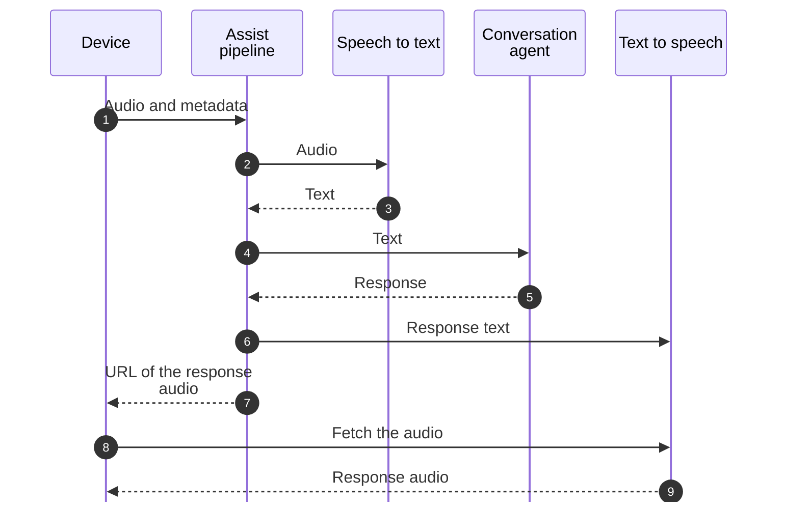
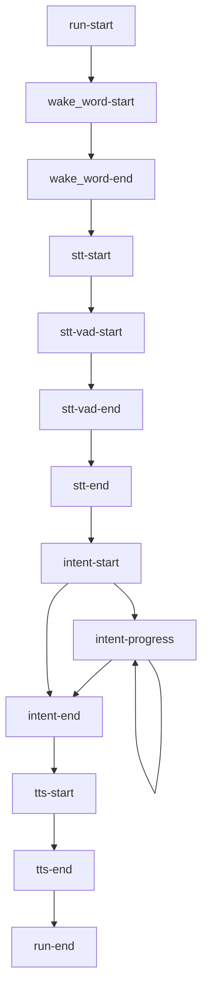

# Assist 管道 {#assist-pipelines}

在Home Assistant中的声音是一个小部分的链条,每个小部分有一个工作. An [输油管](/glossary/assist-pipeline) 把它们串在一起 。的来源是: 语音卫星,像一个聪明的扬声器一样,只需捕捉音频并播放回放的答案: Home Assistant其余部分都是.

## 声音如何通过 Home Assistant {#how-voice-flows-through-home-assistant}

1. 一个设备将音频流到管道,其元数据如样本率.
2. ** Wake word survey** 聆听唤醒词,如"OK Nabu". 可选性:许多设备自行探测.
3. 冉   pe pe
4. ** 有意承认** 使该案文成为[对话代理](/glossary/conversation-agent)。 内置代理匹配到 [意图](/core/internals/intents), 处理后返回响应 。 以语言模型为后盾的特工会以自己的方式到达那里.
5. ** 语音文本** 将答复变成音频。
6. 设备播放实情

同样的流,一步步, 对于一个设备 探测醒字本身:



每个部分都是自己的整合,有一个匹配的实体类型,整合提供:

- 运行管道。
- `wake_word` 探测到唤醒字。 提供商为[唤醒单词实体](/core/entities/wake-word).
- `stt`把语音变成文字。 提供商为[语音对文本实体](/core/entities/stt).
- `conversation` 处理文本 。 探员是[对话实体](/core/entities/conversation)。
- 将文字变成语音 提供商为[娇色的文字实体](/core/entities/tts).

用户在**Settings**下设置管道 ** 语音助理**,为每一步骤选择一种语言和提供者。 作为语音卫星的装置是[Assist 卫星实体](/core/entities/assist-satellite),它为你运行一条管道.

## 运行一个管道 {#run-a-pipeline}

非Assist卫星实体的客户端,如应用或自定义设备,运行在WebSocket上的管道 使用 `assist_pipeline/run` 的 API :

```json
{
  "id": 7,
  "type": "assist_pipeline/run",
  "start_stage": "stt",
  "end_stage": "tts",
  "input": {
    "sample_rate": 16000
  }
}
```

[网络语音助理](https://github.com/OHF-Voice/websocket-voice-assistant) 工程是一个完整的示例客户端 。

| 外地 | 说明 |
| --- | --- |
| `start_stage` | 要求。 运行的第一阶段: `wake_word`,`stt`,`intent`,或`tts`. |
| `end_stage` | 要求。 最后一个要运行的阶段: `stt`, `intent` 或 `tts` 。 |
| `input` | 取决于起步阶段. 见下文。 |
| `pipeline` | 输油管的标识 首选管道的默认值 。 列出他们。 |
| `conversation_id` | 继续之前的对话。 见[对话框 API](/core/internals/conversation-api#conversations). |
| `device_id` | 设备,从设备注册, 启动管道。 |
| `timeout` | 数秒后,整个运行时间结束。 默认为300. |

加进 `input` 的内容 :

- 从 `wake_word` 开始 : `sample_rate` (必须), `timeout` 在放弃( 默认 3) 之前的几秒静默, 而 [音频增强](/core/internals/assist-pipelines#audio-enhancements) 。
- 从 `stt` 开始 : `sample_rate` (需要), 可选的 `wake_word_phrase` , 设备上检测到的唤醒词 。 Home Assistant用它来避免几个设备回答同一个醒字.
- 从`intent`或`tts`开始:`text`。

## 傀儡 {#events}

运行时, 管道会发送`event` 信件通过连接, 与运行命令的`id` 。 每个事件都有 `type` 和 `data` :

| 积极地濑子事件 | 何时 | 数据 |
| --- | --- | --- |
| `run-start` | 总是 | `pipeline`,`language`,`conversation_id`,`runner_data`与`stt_binary_handler_id`和`timeout`,和`tts_output`,与`url`和`token`的响应音频,它的`mime_type`和`stream_response`。 |
| `wake_word-start` | 仅音频 | `engine`, 音频 `metadata` 和 `timeout` 。 |
| `wake_word-end` | 仅音频 | `wake_word_output` 与 `wake_word_id` , 和 `timestamp` 以毫秒计, 从音频开始 。 |
| `stt-start` | 仅音频 | `engine`和音频`metadata`。 |
| `stt-vad-start` | 仅音频 | `timestamp` 当语音命令开始时, 从音频开始, 以毫秒计 。 |
| `stt-vad-end` | 仅音频 | 所获的语音命令何时结束 。 |
| `stt-end` | 仅音频 | {H0 38.}与公认的`text`。 |
| `intent-start` | 总是 | `engine`(代理),`language`和`intent_input`,文本。 |
| `intent-progress` | 有些探员 | `chat_log_delta` 以一个响应作为代理流, 或{H 罗} 当文字到语音在回答完成前开始 。 |
| `intent-end` | 总是 | `intent_output`,一个[对话响应](/core/internals/conversation-api#the-response),和`processed_locally`。 |
| `tts-start` | 仅音频 | `engine`,`language`,`voice`和`tts_input`,要发言的文本。 |
| `tts-end` | 仅音频 | `tts_output`与音频的`url`,`token`,`mime_type`和`media_id`。 |
| `run-end` | 总是 | 没什么 |
| `error` | 错误 | 一个`code`和一个`message`。 |

### 活动顺序 {#event-order}

从醒悟到口头回答,



并不是每次跑都送来

- 运行只发送其`start_stage`和`end_stage`之间的阶段事件. 从`intent`开始的运行,文本从`run-start`直到`intent-start`。
- `stt-vad-start` 和`stt-vad-end` 只有在 Home Assistant 检测到语音命令本身的结尾时, 才会出现, 对于一个需要它的语音到文本的提供者.
- `intent-progress`只能来自源源不断地反应的特工,并且可以来很多次.
- 当响应没有文本可发言时,运行会跳过文本到语音,从`intent-end`到`run-end`,除非它播放确认声音。
- 当在音频结束前没有听到唤醒词时,`wake_word-end`会在没有唤醒词的情况下出现,然后是`run-end`.
- 当一个阶段失败时,运行发送`error`,然后发送`run-end`. 之后没有其他事件。
- 当整个运行比它的`timeout`需要更长的时间时,命令翻转:Home Assistant取消运行,它发送`run-end`,然后用代码`timeout`发送`error`. 所以不要停止在 `run-end` 听, 或者你错过这个错误。

### 错误代码 {#error-codes}

- `wake-engine-missing`:没有安装醒字引擎 。
- `wake-provider-missing`: 唤醒词提供者不可用 。
- `wake-stream-failed`: 醒字检测时出错.
- `wake-word-timeout`: 超时之内没有唤醒消息 。
- `stt-provider-missing`: 语音对文本提供者不可用 。
- `stt-provider-unsupported-metadata`: 提供者不支持音频格式, 如样本率 。
- `stt-stream-failed`: 语音到文本时出错 。
- `stt-no-text-recognized`:对文本的语音返回什么也没有。
- `cloud-auth-failed` : Home Assistant Link 无法认证 。
- `intent-agent-not-found`:对话代理不存在.
- {H0al}: 对话代理无法使用 。
- `intent-failed`: 故意识别时出错.
- 蝎子 `tts-not-supported`: 文本对语音提供者不可用, 或者不支持选项 。
- `duplicate_wake_up_detected`:另一个设备已经回答过同一个唤醒词 。
- `timeout`:整个运行耗时长于它的`timeout`.

## 发送音频 {#send-audio}

一旦获得`run-start`,就立即将音频作为二进制WebSocket消息发送。 以一个字节开始每个消息: `stt_binary_handler_id` 从`runner_data` 开始 。 对于处理器 ID `1` 和音频字节 `a1b2c3` , 信息是:

```text
01a1b2c3
```

音频为原始PCM: 16位单样, 在 `sample_rate` 您通过 。 Home Assistant将其他样本率转换为16000赫兹.

裘 To为标记音频的结尾,发送一个只有处理器ID字节的二进制消息.

## 醒字检测 {#wake-word-detection}

以 `start_stage` 设定为 `wake_word` , 管道等待它听到唤醒的单词, 然后继续演讲到文本 。 `input`中的`timeout`是它放弃`wake-word-timeout`之前的沉默秒数. 当Home Assistant听到演讲时,超时会不断重置.

将音频流到所有的时间成本网络和CPU. 在设备上使用语音活动检测,仅在有人说话时使用流线.

### 作法 {#audio-enhancements}

在`wake_word`开始时,`input`也可以有:

- `noise_suppression_level`: 0(关闭)至4(最大).
- `auto_gain_dbfs`:自动增益,0(关闭)至31(最大).
- `volume_multiplier`: 复制音频样本 。 1.0 改变什么,2.0 倍于音量.

对于安静的麦克风,请尝试`noise_suppression_level`2,`auto_gain_dbfs`31,和`volume_multiplier`2.0. 转动噪音抑制或乘数太远扭曲音频.
